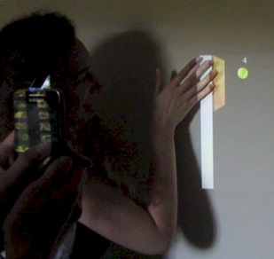

# CamPong

CamPong explored using a phone camera and projector for a two-player Pong game. Hand positions beside the projected court controlled the paddles.

Original project: **Rom Herschkovitz and Nofar Carmeli**. Supervision: **Aaron Wetzler**.

*Historical camera/projector setup; not a current browser result.*

The report, poster, slides, overview and historical recording are preserved. Original game source is still missing; a supplied archive contained a scanner rather than identified Pong code and has not been imported.

## Updated

**[Open the browser demo](https://twerdster.github.io/campong/)** · [Updated guide](updated/README.md)

This new browser game is not recovered source. Pointer/touch mode plays the left paddle against a computer paddle. Optional camera mode controls both paddles through background subtraction in two stripes. Camera-mode tracking passed synthetic-frame checks; a physical camera, projector alignment and tracking accuracy remain untested.

[Demo controls, local serving and checks](updated/demo/README.md) · [Original report](docs/report.pdf) · [Recovery note](docs/SOURCE-RECOVERY.md)

## Project record and rights

[Historical context, attribution and recovery details](PROJECT_RECORD.md) preserve the earlier record. Original material, datasets, dependencies and new code keep their separately stated terms; no blanket license is added.
