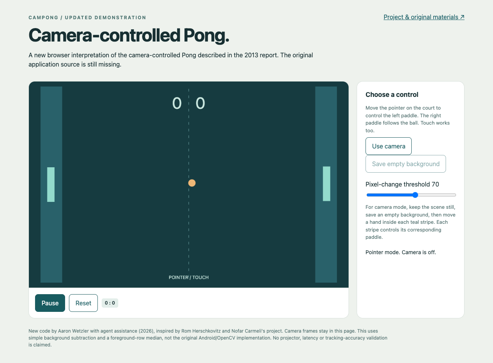

# CamPong: updated work

## Updated work

**[Open the browser demo](https://twerdster.github.io/campong/)**

A **new browser demonstration** implements Pong with pointer/touch controls and optional camera-background subtraction. It illustrates the reported interaction; it does not restore the Android application or validate a projector setup.

[Browser demo guide](demo/README.md) describes local use, checks and limitations.

Historical project: Rom Herschkovitz and Nofar Carmeli; supervision: Aaron Wetzler. New implementations are labeled separately and do not change the preserved materials.

*Actual Chrome interface capture. Its input and execution scope are described above and in the demo guide.*
